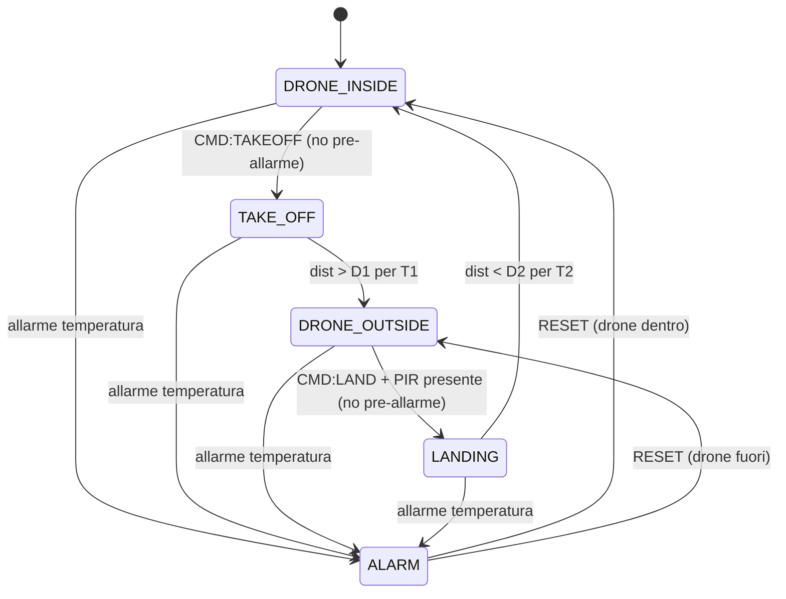
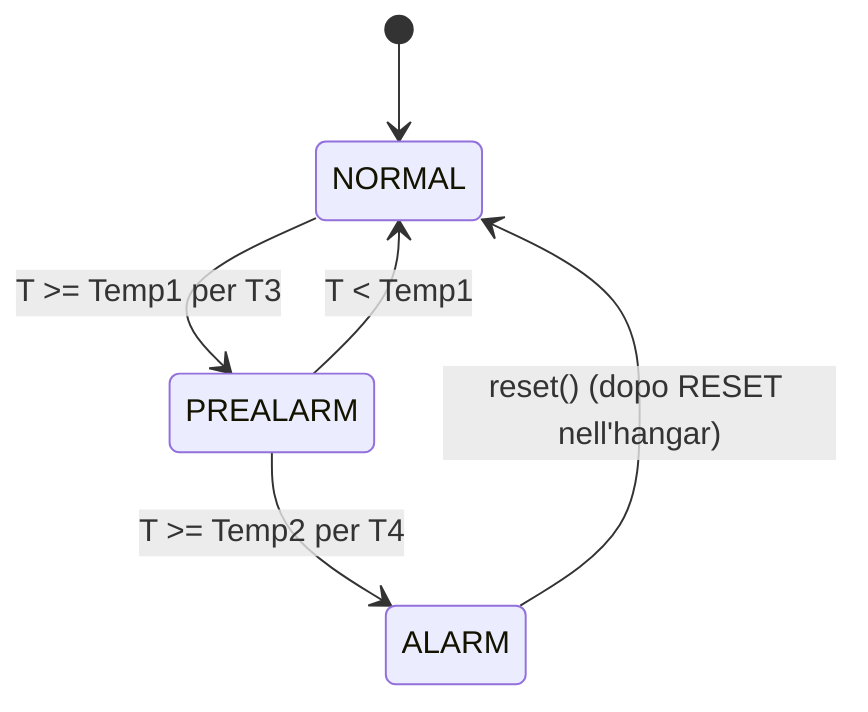

# Assignment 02 — Smart Drone Hangar

Sistema a due sottosistemi che comunicano via **seriale**:
- `drone-hangar/` — Arduino UNO (task + FSM sincrone)
- `drone-remote-unit/` — DRU, GUI web PC (Node.js + socket.io)

## Da allegare
- **Diagramma FSM**: fatto
- **Schema circuito** (TinkerCad/Fritzing): fatto
- **Video dimostrativo**: fatto

## Architettura Arduino (task-based + FSM sincrone)
Scheduler cooperativo a base-period; ogni task riceve solo ciò che gli serve:
- **SensorTask**: legge sonar, PIR, temperatura.
- **TemperatureTask**: FSM temperatura `NORMAL → PREALARM → ALARM`.
- **ControlTask**: FSM principale dell'hangar (porta, L1/L3, LCD, comandi).
- **BlinkTask**: lampeggio di L2 (0.5 s) durante take-off/landing.
- **SerialTask**: comandi in ingresso e telemetria in uscita (`SerialProtocol`).

## FSM principale



- **DRONE_INSIDE**: porta chiusa, L1 acceso, LCD `DRONE INSIDE`.
- **TAKE_OFF**: porta aperta, LCD `TAKE OFF`, L2 lampeggia.
- **DRONE_OUTSIDE**: porta chiusa, LCD `DRONE OUT`.
- **LANDING**: porta aperta, LCD `LANDING`, L2 lampeggia.
- **ALARM**: porta chiusa, L3 acceso, LCD `ALARM`; sospeso fino a RESET.
- **Pre-allarme** (T≥Temp1 per T3): sospende i **nuovi** take-off/landing;
  un'operazione già in corso può completarsi.

## FSM temperatura (TemperatureTask)



## Pinout (Arduino UNO)
| Componente          | Pin        |
|---------------------|------------|
| L1 verde / L2 verde / L3 rosso | D2 / D3 / D4 |
| RESET (button)      | D5 (INPUT_PULLUP) |
| Servo porta (HD)    | D6         |
| PIR (DPD)           | D8         |
| Sonar (DDD) trig/echo | D9 / D10 |
| Temperatura (TEMP)  | A0 (analog, LM35) |
| LCD I2C 16x2        | SDA=A4, SCL=A5 (0x27) |

## Protocollo seriale (9600 baud)
- **DRU → hangar**: `CMD:TAKEOFF`, `CMD:LAND`
- **hangar → DRU** (ogni 1 s):
  `STATE:<s>,TEMP:<t>,DIST:<d>,PREALARM:<0|1>,ALARM:<0|1>`
  con `s ∈ {DRONE_INSIDE, TAKE_OFF, DRONE_OUTSIDE, LANDING, ALARM}`.

## Parametri (`drone-hangar/include/config.h`)
`D1=50cm T1=3s`, `D2=15cm T2=3s`, `Temp1=30°C T3=5s`, `Temp2=40°C T4=5s`
(valori di prototipazione, modificabili).

## Avvio DRU
```
cd drone-remote-unit
npm install
# imposta la porta seriale in .env (SERIAL_PORT)
npm start   # http://localhost:3001
```
